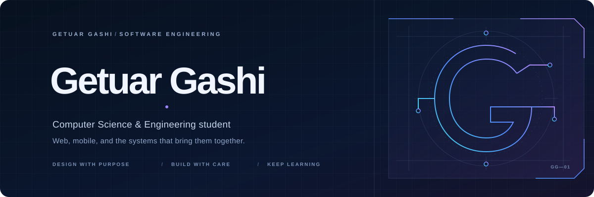

# Getuar Gashi

**Computer Science & Engineering student · Software developer**

## About me

I’m a Computer Science and Engineering student interested in web development, mobile applications, and software engineering. I enjoy working across the stack, from shaping an interface to connecting it with the systems behind it.

## Tech stack

- **Web:** JavaScript, TypeScript, React, Vite, Tailwind CSS
- **Mobile:** React Native, Expo
- **Backend & data:** Node.js, Express, MySQL

## Featured projects

### [G.G Strategy](https://github.com/Getuar333/gg-strategy)

A full-stack productivity and planning web application, with task, meeting, notification, and productivity-statistics workflows.

**Built with:** React, TypeScript, Vite, Tailwind CSS, Node.js, Express, MySQL

**Links:** [Repository](https://github.com/Getuar333/gg-strategy) · [Project demo](https://gg-strategy.netlify.app/)

### [UBT FindPoint](https://github.com/ertihoxha5/UBT-FindPoint)

A collaborative UBT lost-and-found mobile app for reporting and browsing lost and found items. My contributions include work on its chat module and calendar/report integration.

**Built with:** React Native, Expo, TypeScript, Node.js, Express, MySQL

**Link:** [Repository](https://github.com/ertihoxha5/UBT-FindPoint)

## Contact

- [GitHub](https://github.com/Getuar333)
- [LinkedIn](https://www.linkedin.com/in/getuar-gashi-5490b4336/)
- [Email](mailto:getuar.gaming@gmail.com)
